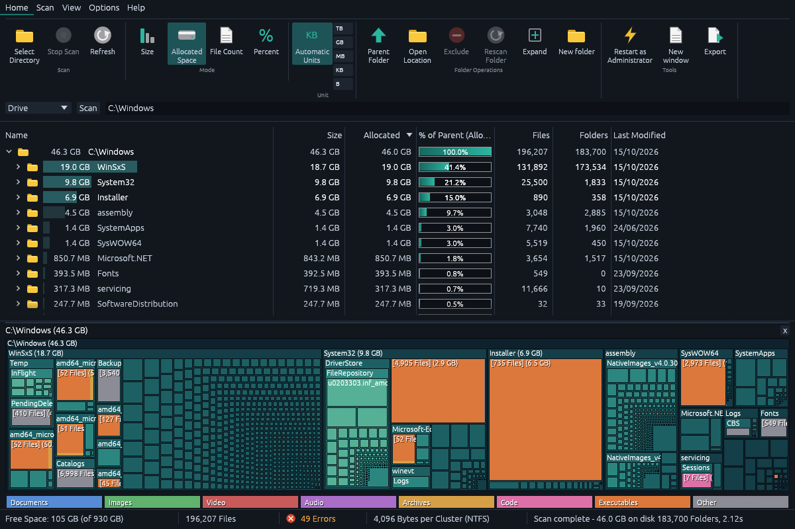
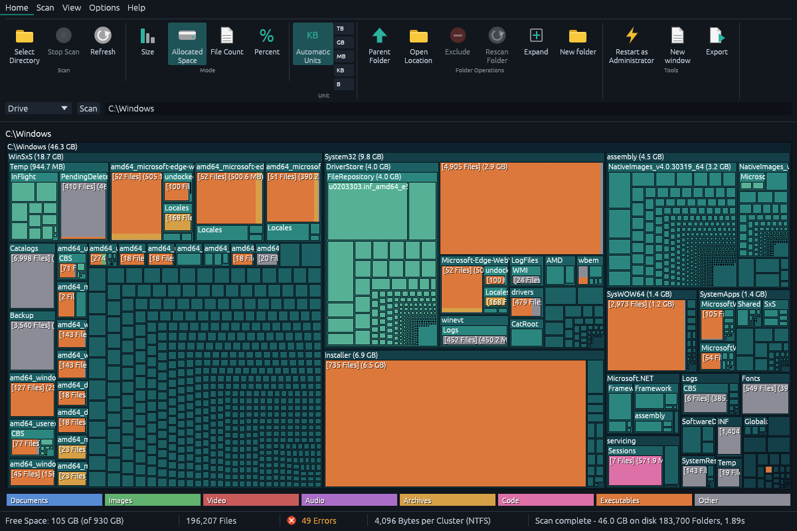
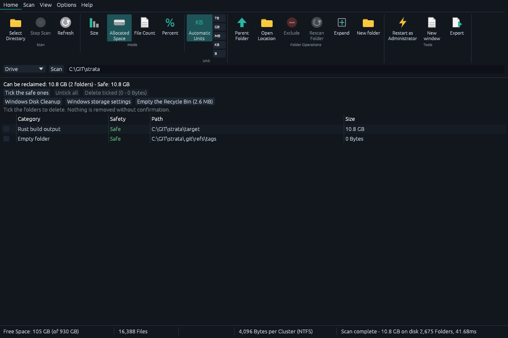
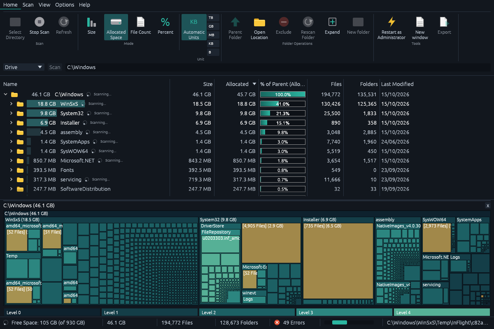
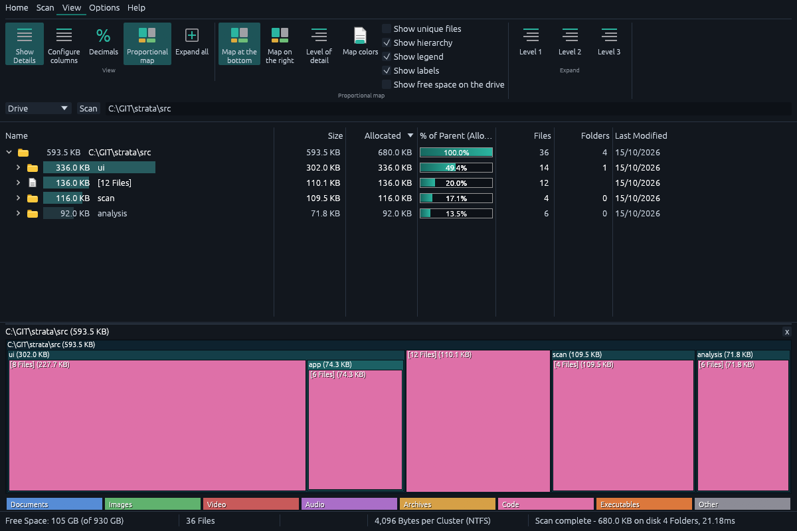

# Strata

A fast disk space analyzer for Windows, written in Rust. Scan a drive, see where the space went in a
live tree and a proportional map, find what can be cleaned, and keep a history to see what grew.



## Highlights

- **Live scan**: the tree and the map fill in while the drive is read (about 12 s for a 3.75 M-file
  drive on a fast SSD, 3 to 8 s for `C:\Windows` depending on the cache). Stop keeps what was found.
- **Start page**: one card per drive with its free space, common folders (your user folder, Downloads, Desktop,
  Documents, local app data, all users, temporary files) and the recent folders: one click starts a scan.
- **Proportional map** docked under (or beside) the tree, 5 nesting levels, individual files,
  free-space tile, follows the selection. Files are coloured by type (documents, images, video, audio,
  archives, code, executables; a block of mixed files is cut into proportional strips), with details
  on hover. Switch to colours by folder level in the View tab.
- **Scan history**: every finished scan is stored; the Changes view ranks what grew or vanished since
  any earlier scan, with a size-over-time chart.
- **Clean-up**: reclaimable folders, each marked *Safe* (regenerated automatically) or *Check first*:
  build output and dependency folders of your projects (`node_modules` with a lock file, Cargo `target`,
  .NET `bin`/`obj`, `__pycache__`, ...), browser caches, `AppData\Local\Temp`, crash dumps, package-manager
  caches, `Windows.old`; plus empty folders, duplicate files (keep one copy; hard links are not copies) and
  size by file age and big files not modified for over a year (always "Check first"). Dependency folders of
  installed programs and globally installed tools are never offered. For what Strata does not delete itself
  (Windows Update files, system logs) there are buttons for Windows Disk Cleanup and the storage settings.
- **Safe by default**: deletions go to the Recycle Bin after a confirmation; a banner then says the space is only
  freed once it is emptied and offers to empty it (after asking: it empties the whole bin, and shows its size).
  "Delete permanently" is an unticked option of the confirmation; drive roots, the Windows and program folders and
  the profile folders themselves are always refused. Deletions run in the background with progress and a Stop button.
- **Explorer-like actions**: right-click menu on every row (open, terminal, rename, new folder,
  rescan one folder, copy path, properties), Ctrl/Shift multi-selection, keyboard navigation,
  drag a folder onto the window to scan it.
- **Honest about what it cannot read**: without administrator rights, the start page explains what may be
  missing, and after a scan a banner counts the folders refused ("access denied"), lists them, and for a whole
  drive compares what the drive reports as used with what was found. One click restarts Strata as
  administrator (or always, in Options); the reminder can be turned off.
- **Opens without OpenGL**: when a machine has no usable OpenGL (some virtual machines, remote sessions), the window
  is drawn with DirectX 12 instead, on the CPU if there is no graphics card.
- **Command line** for scripts and scheduled tasks: `strata --cli PATH --export report.csv|json|html --changes --cleanup`;
  `--fast` reads the NTFS Master File Table of a whole drive (administrator only).
- English and French interface; light and dark theme.

| | |
|---|---|
|  |  |
|  |  |

## Install

Strata is a single `strata.exe`: no installer, no runtime to install (the C runtime is linked in; only
Windows system DLLs are needed). The window is drawn with OpenGL when the machine has it; otherwise
(for example some virtual machines) with DirectX 12, on the CPU when there is no graphics card.
`strata.exe --renderer opengl|directx|software` forces one of them.

Download the zip of a release, unpack it anywhere and run it. Settings and scan history live in
`%APPDATA%\strata`; for a **portable** copy (USB stick, shared folder), create an empty file named
`strata.portable` next to `strata.exe` and they are kept in `strata-data` beside it instead. Releases also carry a
per-user MSI (no administrator rights, Start menu shortcut, clean uninstall); see `docs/RELEASING.md` for how
releases and the winget listing are made.

If the window cannot be created, or Strata stops unexpectedly, it says so in a message box and writes `crash.log` in
the settings folder. Help > About > Copy diagnostics gives the version, Windows build and graphics driver to paste
into a bug report. `strata --cli PATH` needs no window.

## Keyboard shortcuts

| Keys | Action |
|---|---|
| Ctrl+O | Choose a folder to scan |
| F5 | Refresh (scan again) |
| Ctrl+Shift+B | Stop the scan |
| Ctrl+Shift+N | New window |
| Ctrl+F | Find in the tree |
| Ctrl+1 to Ctrl+4 | Sort by size, allocated space, percent, file count |
| Ctrl+E | Expand everything |
| Arrows, Home, End, Page Up/Down, Enter | Move in the tree, expand or collapse |
| Backspace or Alt+Up | Parent folder |
| Ctrl+C | Copy the path of the selection |
| Delete | Delete the selection (asks first; Recycle Bin by default) |
| Ctrl+Shift+X | Exclude the selected folder from scans |

## Scan history from a scheduled task

Every finished scan is stored, and `--changes` stores one without opening the window, so the Changes view can fill
up by itself. For example, a scan of `C:\` every Sunday at 03:00 (adjust the path to `strata.exe`):

```bat
schtasks /Create /TN "Strata weekly snapshot" /SC WEEKLY /D SUN /ST 03:00 /TR "\"C:\Tools\strata\strata.exe\" --cli C:\ --changes"
```

A hidden run with no console exits with code 0 and stores its snapshot in `%APPDATA%\strata\snapshots`; the next run
reports what changed since the previous one. Adding `/RL HIGHEST` and `--fast` would make the scan complete and
quicker, but that variant has not been tried.

## Run

```bash
cargo run --release -- [PATH]            # GUI, PATH is scanned at startup
cargo run --release -- --cli PATH -d 3   # headless tree
cargo test                               # unit tests and windowless UI tests
```

Developer flags: `--screenshot FILE.png [--view tree|treemap|chart|types|largest|oldest|duplicates|compare|cleanup|age] [--tab N] [--dialog options|about] [--lang fr] PATH`
renders one frame and exits (this is how the pictures above are made); `--screenshot-live` captures during the scan.
`--simulate-no-opengl` makes the OpenGL set-up fail to test the DirectX fallback, and `--simulate-start-failure`
shows the message of a window that cannot be created.

## Layout of the code

| Path | Role |
|---|---|
| `src/scan/` | parallel walker (rayon), compact tree, live snapshots, NTFS MFT reader (opt-in) |
| `src/analysis/` | file types, filters, duplicates, snapshots and history, clean-up insights |
| `src/ui/` | egui app: ribbon, tree table, map, views, theme, painter glyphs; `launch.rs` picks OpenGL or DirectX |
| `src/ui/app/` | deletion, Recycle Bin, dialogs, ribbon and the windowless UI tests |
| `src/spec.rs` | commands and the keyboard shortcut table |
| `src/i18n*.rs` | English source strings, French table, audited by a test |
| `src/shell*.rs`, `src/trash.rs` | Win32: open/terminal/properties, known folders, Recycle Bin, Explorer menu entry |
| `src/diag.rs` | crash log, start-up error message, diagnostics |
| `installer/`, `docs/RELEASING.md` | per-user MSI (WiX), winget manifest templates, how a release is made |
| `tools/` | measurement and NTFS validation scripts, icon generator (own artwork) |

## Status and limits

- The NTFS fast scan ("Fast NTFS scan (admin)" in the ribbon, `--fast` on the command line) needs administrator
  rights and a whole drive, is off by default and falls back to the normal walker with a message. Checked against
  the normal scan on a real 252 GB volume (95,078 files): same sizes and folder count, every hard link listed
  under its own name, 3 more files (in `System Volume Information`, which the normal scan may not read), and 1.2 s
  instead of 79 s on a cold cache. Compare it on your own drives with `tools/validate_mft.ps1`.
- The DirectX fallback was checked on a PC by forcing the software adapter (`--renderer software`) and by making
  OpenGL fail on purpose (`--simulate-no-opengl`); it has not been run inside a Hyper-V guest yet. It makes the
  program about 5 MB bigger, and the software adapter uses a little more memory and some CPU.
- The executable is not code-signed yet, so Windows SmartScreen may warn the first time it is run.
- Network shares and OneDrive "online-only" files are scanned like any other folder; they have not been tested
  specifically.
- Windows is the target platform. Linux builds and passes its tests; macOS is not maintained.
- Memory for `C:\Windows` (measured with `tools/measure.ps1`): about 230 MB peak and about 160 MB once the
  scan is done (110 MB of that is the window itself); about 1 GB peak for a 3.75 M-file drive.

## Provenance

Strata is an independent project. The source code, the icon (generated by `tools/make_icon.py`),
the theme, the menu table and the English and French strings were all written for it. Apart from its
Cargo dependencies, the repository contains no third-party code, artwork or translation catalogues.

## License

MIT, see `LICENSE`.
